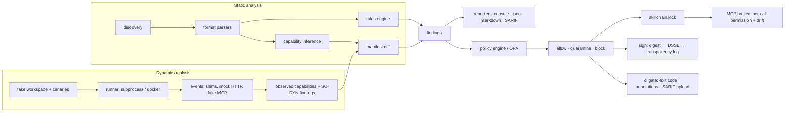

# Architecture

## Modules

| Module | Responsibility | Key types |
|---|---|---|
| `core.models` | Frozen pydantic models shared everywhere | `Finding`, `Severity`, `Confidence`, `SkillPackage`, `SkillScan`, `ScanResult`, `CapabilityManifest`, `PolicyVerdict` |
| `core.hashing` | Deterministic tree digest (sorted POSIX paths, content, exec bit; no mtimes) | `tree_digest()` |
| `core.config` | `.skillchain.yaml` | `ScanConfig` |
| `formats.discovery` | Finds packages; table-driven by filename/suffix | `discover_packages()` |
| `formats.base` | Frontmatter split, binary detection, script/config/instruction classification | `read_skill_file()` |
| `formats.configs` | JSONC parsing, MCP server dialect normalisation | `McpServer`, `extract_mcp_servers()` |
| `rules.*` | One module per category; `RegexRule` for declarative rules, `Rule` for logic | `RuleRegistry`, `RuleDescriptor` |
| `rules.custom` | YAML rule packs validated by pydantic | `CustomRuleSpec` |
| `capabilities.taxonomy` | Capability names, tool→capability globs, `covers()` | `CAPABILITIES`, `TOOL_CAPABILITIES` |
| `capabilities.inference` | Evidence collection; strong (script/config/tool) vs weak (prose) | `infer_capabilities()` |
| `capabilities.manifest` | Declared manifest extraction, diff, `SC-MAN-*` findings | `diff_manifests()`, `manifest_findings()` |
| `scanner.engine` | Orchestration, suppressions (inline + baseline), sorting | `Scanner` |
| `report.*` | Renderers; SARIF carries rule metadata, fingerprints, `security-severity` | `to_sarif()` |
| `policy.engine` | YAML schema + evaluator; heuristic gating | `Policy`, `PolicyEngine` |
| `policy.opa` | Shell-out to `opa eval` | `evaluate_with_opa()` |
| `sandbox.*` | Canaries, workspace, shims, mock HTTP, fake MCP, runner, analysis | `detonate()` |
| `signing.*` | Keys, pack, attestation (DSSE/in-toto), sign/verify, transparency log, Sigstore/cosign | `sign_package()`, `TransparencyLog` |
| `lockfile.lock` | Lock schema, generation, verification | `Lockfile`, `verify_lock()` |
| `broker.proxy` | JSON-RPC stdio proxy with decisions, audit, drift | `Broker`, `decide()` |
| `ci.gate` | Exit-code contract, GitHub annotations/outputs | `evaluate_gate()` |
| `cli.app` | Typer application | `skillchain` |

## Data flow guarantees

- **Findings are immutable** (`frozen=True`) and carry a `fingerprint` derived from `(rule_id, path, snippet)` so
  baselines survive line shifts.
- **Capabilities are hierarchical strings**; `network` covers `network.egress`. Declared parents satisfy inferred
  children.
- **Weak evidence never blocks.** Prose-only capabilities are listed in `CapabilityManifest.weak`; manifest
  findings for them are heuristic, and policy deny/quarantine lists look only at `strong`.
- **Observed ≠ inferred ⇒ `SC-MAN-004` (critical).** The sandbox's observed manifest is compared with static
  inference; anything that only appears at runtime is flagged.
- **One bad package never aborts a run.** Exceptions are captured per package into `ScanResult.errors`
  (exit code 10 in CI).

## Extension points

- New host format: add filename/suffix to `formats.discovery` tables.
- New rule: subclass in `rules/<category>.py`, append to `RULES`.
- New capability: add to `CAPABILITIES`, map tools in `TOOL_CAPABILITIES`, add inference regexes.
- New sandbox observation: emit an event type from a shim; map it in `sandbox.detonate._analyse`.
- New policy condition: extend `policy.engine.When` and `_rule_matches`.
